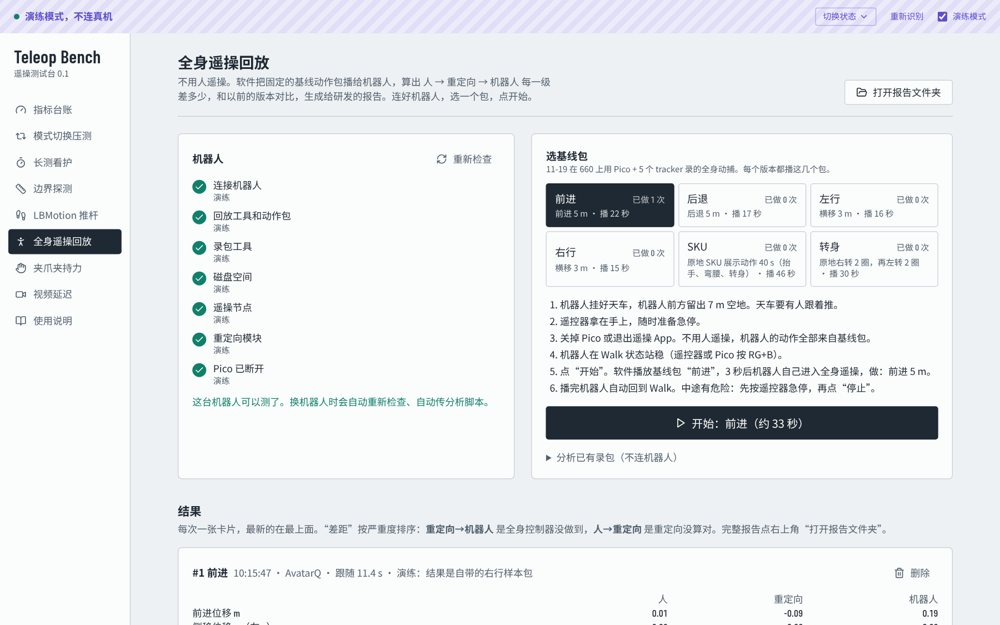
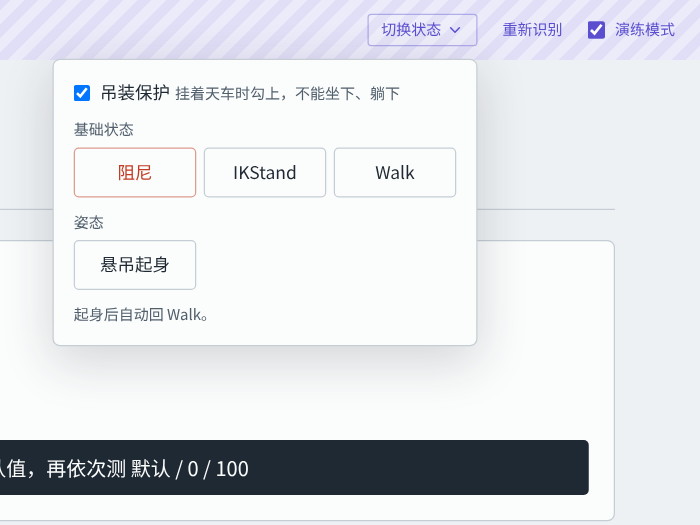
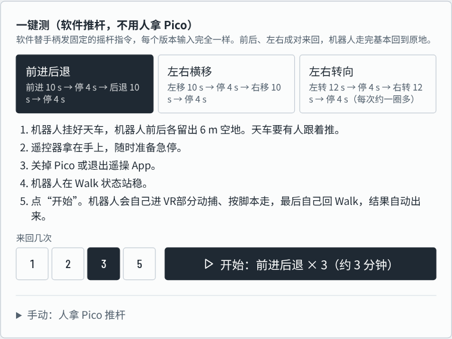
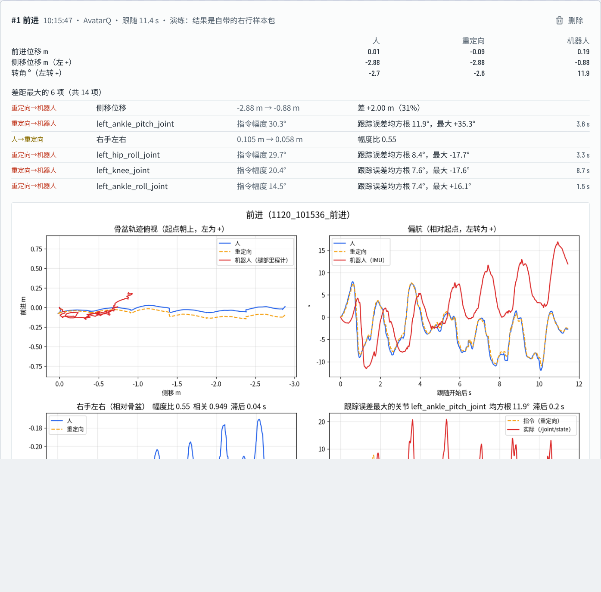

# 遥操测试台 Teleop Bench

给遥操作测试用的桌面软件：连上机器人，选一项测试，点“开始”，结果和报告自动出来。不用人拿 Pico 遥操的测试，软件自己替手柄发指令。

## 安装（第一次，约 10 分钟）

| 步 | 做什么 |
|-|-|
| 1 | `git clone https://github.com/cyres03/teleop-bench.git`，进目录运行 `bash install.sh`，最后显示“N passed”就装好了 |
| 2 | 连上机器人热点（`HU_` 开头），运行 `bash robot-access.sh`，按提示输入机器人 limx、guest 密码。每台机器人只做一次 |
| 3 | 应用菜单或桌面点“遥操测试台” |

没有机器人时勾右上角“演练模式”，所有页面都能先走一遍。

## 每次测试前

1. 机器人挂好天车，遥控器拿在手上。
2. 关掉 Pico（一键测试由软件发指令，Pico 连着会两路指令打架）。
3. 顶部“切换状态” → Walk。

## 测什么、点哪里

| 左侧菜单 | 测什么 | 怎么做 |
|-|-|-|
| 全身遥操回放 | 全身跟随：人 → 重定向 → 机器人 每一级差多少 | 选基线包（前进、后退、左行、右行、SKU、转身），点开始 |
| LBMotion 推杆 | 半身行走：指令 → LBMotion → 实际，松杆后停多快 | 选“一键测”的脚本（前进后退、左右横移、左右转向），点开始 |
| 夹爪夹持力 | 夹持力默认、0、100 三档 | 点开始，每档夹特殊塑料杯、拍照上传、点已完成 |
| 模式切换压测 | 坐下↔起身、躺下↔起身、Walk↔动作库 反复切 | 选序列和次数，点开始 |
| 视频延迟 | 端到端视频延迟 | 摆好两台相机，按页面 1–6 步做 |
| 长测看护、边界探测、指标台账 | 长时间跑、动作边界、CPI 记录 | 按页面提示 |

每个测试页左边是检查清单，全部打勾才能开始；开始后弹窗显示进度，有危险先按遥控器急停，再点“停止”。

## 结果在哪

- 页面下方直接显示结果和对比图，差距按严重度排好序。

  
- 报告、图、录包在 `~/.teleop-bench/<页面>/<日期>_<机器人SN>/`，点页面右上角“打开报告文件夹”。
- 全身回放页有“版本对比”表：每个版本播同一批包，直接比。

## 出问题

| 现象 | 怎么办 |
|-|-|
| 检查清单有红叉 | 看红叉下面那行小字，照着做后点“重新检查” |
| “Pico 已断开”是红叉 | 关掉 Pico 或退出遥操 App |
| 顶部显示“未连接机器人” | 连机器人热点，点“重新识别”；新机器人先跑一次 `robot-access.sh` |
| 机器人不动 | 看弹窗里哪一步失败；机器人要先在 Walk |
| 界面没有样式、全是白底文字 | 重新运行 `REBUILD_UI=1 bash install.sh` |

## 安全

- 机器人会自己动：每次都挂天车、拿着遥控器。
- 阻尼、坐下、躺下、改配置都要在软件里再确认一次。
- 每条发给机器人的指令都记在本地审计日志里。

详细说明（每页的算法、指标、阈值）：[docs/使用说明.md](docs/使用说明.md)
